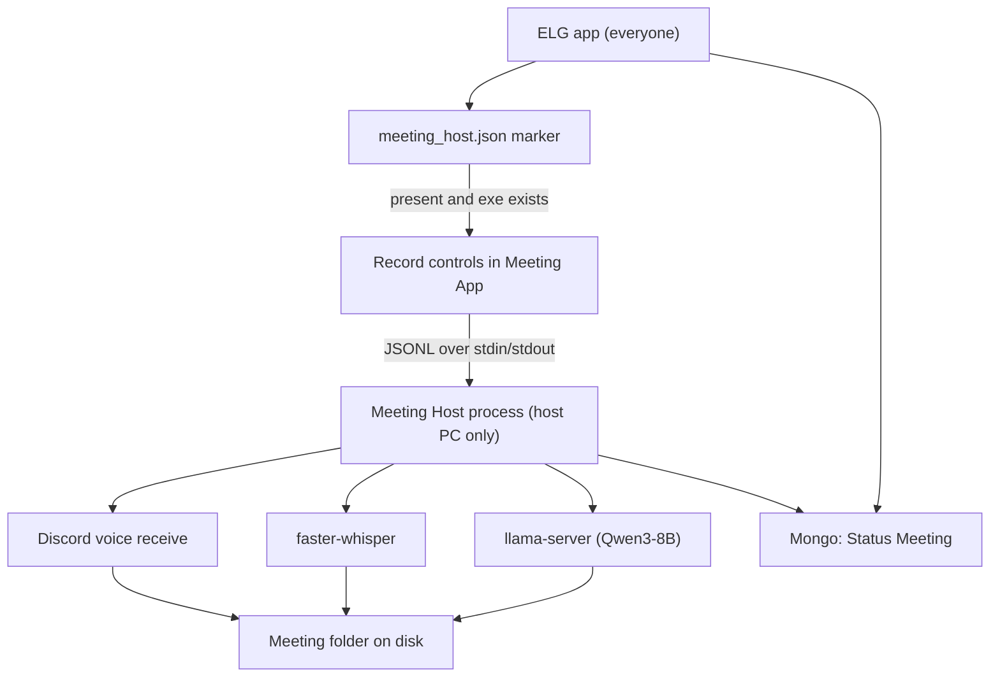

# Meeting Mike (ELG Meeting Host)

Optional sidecar that records a Discord status meeting, transcribes it locally
and writes a fixed-format summary. It ships as a **separate Windows
installer**: the ELG app everyone installs stays small and never imports
Discord, Whisper or llama.cpp.

## What the split looks like



If the marker is absent the meeting view is byte-for-byte what it was before:
[src/meeting_mike_panel.py](../src/meeting_mike_panel.py) `attach()` returns
`None` and no widgets are created.

## Locked choices

| Area | Choice |
|---|---|
| Distribution | Separate `ELG-Meeting-Host` installer, Windows x64 |
| Language | English only |
| Mix transcription | faster-whisper `distil-large-v3` (source of truth for wording) |
| Per-speaker transcription | faster-whisper `small.en` (attribution and overlap repair) |
| Merge and summary | Qwen3-8B Instruct Q4_K_M via bundled `llama-server`, thinking off |
| Speaker attribution | Model-assisted, with a deterministic overlap fallback |
| Storage | Local only; nothing is uploaded |
| Channel | Host's current voice channel, else the tuxedo `boardroom` channel |

## One-time setup

1. **Create the bot** at the Discord developer portal. Enable the
   **Server Members** privileged intent (Guilds and Voice States are not
   privileged). Invite it with **View Channel** and **Connect** only.
2. **Add GitHub secrets** `DISCORD_BOT_TOKEN` and `DISCORD_GUILD_ID`.
   `MONGODB_URI` is reused from the ELG build. Until both exist the Host job
   fails and the release simply ships without the Host installer
   (`continue-on-error: true`).
3. **Install** `ELG-Meeting-Host.exe` on the one machine that records.
4. **Link Discord** in ELG: Settings has a Discord user-ID field (or run
   `/link`). Recording refuses to start without it, because that id is how the
   bot finds which voice channel you are in.

Models are **not** in the installer. The first recording downloads about 7 GB
into `%LOCALAPPDATA%\ELG Studio\ELG-app\meeting_mike\models`.

## Using it

Open **Meeting App**. With the Host installed, a **Record** button appears
bottom-left. Press it to start; press **Stop** to end the meeting and run the
pipeline. Progress is shown inline, and **Open folder** appears when the
summary is written.

Recording survives navigating away from the meeting view and minimising to
tray, because the process is owned by a module-level session in
[src/meeting_mike_client.py](../src/meeting_mike_client.py), not by the view.
Quitting ELG stops it.

## Output layout

```
%LOCALAPPDATA%\ELG Studio\ELG-app\meeting_mike\meetings\2026-W38\20260917T170405Z\
  attendance.json              who was there, late joins, ELG mapping
  audio/mix.wav                clip-safe sum of all speakers
  audio/users/<discord_id>.wav one aligned stream per speaker
  transcripts/mix.json         heavy pass, word timestamps
  transcripts/users/*.json     light pass per speaker
  transcripts/diarized.json    speaker-attributed transcript
  summary.md                   fixed-format summary
  status.json                  pipeline state
```

Every stream shares one timeline that starts at T0, so a late joiner is
padded with leading silence and still lines up in the mix.

## How attribution stays honest

1. A deterministic pass assigns each mix line to the speaker whose own audio
   overlaps it most. This always produces a complete transcript.
2. The model then refines attribution. It is told to keep the mix wording and
   may only replace a line when the mix is garbled *and* an overlapping
   per-speaker line is coherent; those lines are marked
   `"source": "user_fallback"`.
3. Anything the model returns that is invalid (unknown line id, unknown
   speaker, malformed JSON) is discarded and the deterministic result stands.
   `diarized.json` records which path was used in `speaker_attribution`.

Goal outcomes in the summary are computed in
[meeting_host/facts.py](../meeting_host/facts.py) using the same rules as
`src/stats_viewer.py` `classify_user_goal_week`, with actual hours and days
from the same weekly logs the meeting slides display. The model is handed
those results as facts and instructed not to contradict them. If the model is
unavailable the summary is still written, with the factual sections intact.

## Recording lock

`Status Meeting` document `_id: "Meeting Mike"` holds
`{recording, host_username, started_at, channel_id, meeting_dir}`. A second
Record attempt is refused while a fresh lock is held; a lock older than 20
minutes is treated as a crashed host and stolen. The document is upserted, so
existing databases need no migration.

## If ELG closes mid-meeting

The Host watches for stdin EOF. It leaves the voice channel, releases the lock
and keeps the audio, marking `status.json` as `pipeline: "pending"`. Finish it
later:

```powershell
cd "%LOCALAPPDATA%\Programs\ELG Meeting Host"
runtime\python.exe -m meeting_host --resume latest
```

## Development

The Host runs on its own bundled interpreter, so `src/` and `meeting_host/`
never import each other. For local work:

```bash
# meeting_host/runtime_secrets.py is gitignored; env vars work too
export ELG_DISCORD_BOT_TOKEN=... ELG_DISCORD_GUILD_ID=... ELG_MONGODB_URI=...
pip install -r meeting_host/requirements.txt
python -m meeting_host --selftest --elg-data-dir /tmp/elg-data
```

Point ELG at a dev Host by writing the marker yourself:

```json
{
  "schema_version": 1,
  "exe_path": "C:\\Python312\\python.exe",
  "args": ["-m", "meeting_host"],
  "installed_version": "0.0.0-dev"
}
```

### Checks

These need no Discord, Mongo, models or GPU. The first three run in CI:

```bash
python tools/meeting_mike_selftest.py     # audio, merge, facts, summary template
python tools/meeting_host_flow_test.py    # lock, stop vs shutdown, failure paths
python tools/meeting_mike_client_test.py  # ELG-side process/state machine
python tools/meeting_mike_panel_test.py   # Record overlay widgets (local only, needs Tk)
```

`tools/fake_meeting_host.py` speaks the protocol without any heavy deps, which
is how the Record overlay can be exercised on macOS or Linux.

### Building the payload (Windows)

```powershell
python scripts/build_meeting_host.py --arch x64 --gpu-backend none
iscc /DMyAppVersion=0.0.1-test /DMyAppArch=x64 installer\windows\ELG-meeting-host.iss
```

`--gpu-backend cuda` or `vulkan` bundles a GPU `llama-server` into
`llama-gpu/`, which `meeting_host/models.py` prefers automatically. CUDA adds
roughly 550 MB, which is why v1 ships CPU-only. Whisper tries CUDA first and
falls back to CPU `int8`, so GPU acceleration there needs the NVIDIA CUDA pip
wheels that ctranslate2 expects.

## Protocol

ELG to Host, one JSON object per line:

```json
{"cmd":"start","elg_username":"Johan","discord_user_id":"123"}
{"cmd":"stop"}
{"cmd":"shutdown"}
```

Host to ELG: `ready`, `need_models`, `models_ready`, `joined`, `participant`,
`recording`, `stopped`, `phase`, `done`, `error`. Non-JSON lines are ignored
on both sides, so stray library logging is harmless.
